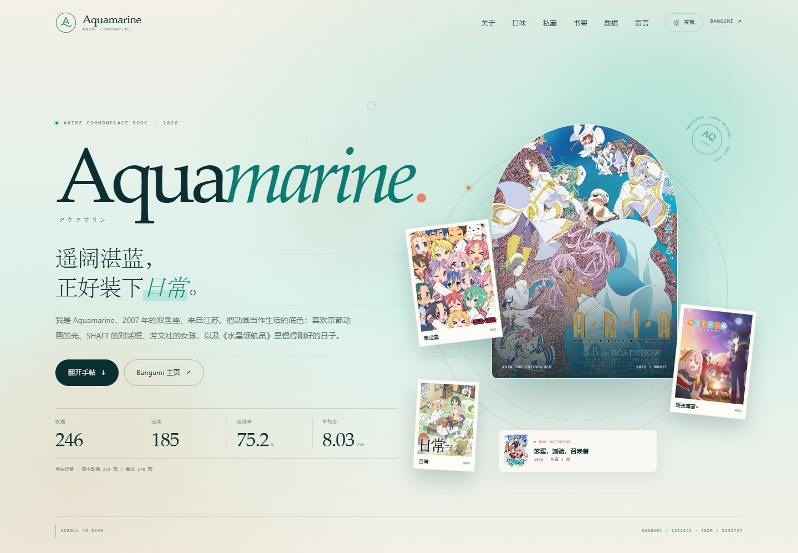
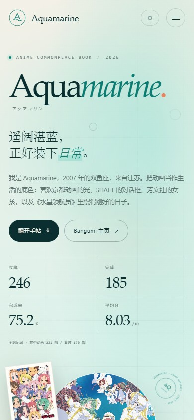

# Aquamarine · 动画手帖

一个为 Aquamarine 做的单页个人介绍网站：把 Bangumi 的 221 部动画收藏、天使动漫的个人资料，以及日常 / 治愈 / 百合 / 京都动画的偏爱，做成一本可以慢慢翻的「动画手帖」。



## 打开方式

最简单：双击 `index.html`，用浏览器打开即可。页面不依赖任何外部字体、CDN 或后端服务。

如果是在手机上直接打开，或者要发给别人，建议用单文件版：

```text
Aquamarine-standalone.html
```

它把 CSS、JS 和 221 张高清封面全部内嵌进了一个 HTML 文件里，不依赖文件夹结构，也不需要联网。文件约 13–14 MB，第一次打开会多等两三秒。



如果想用本地服务器预览：

```powershell
python -m http.server 8765
```

然后访问 <http://127.0.0.1:8765/>。

## 手机单文件版

`Aquamarine-standalone.html` 是专门为手机和转发做的版本：

- CSS、JS、字体样式、221 张高清封面全部内嵌，不依赖 `css/`、`js/`、`assets/`。
- 通过微信 / QQ / 文件管理器发到手机后，用 Chrome、Edge 或小米浏览器打开即可，不会再出现「只有蓝色大 A、没有样式」的问题。
- 约 13–14 MB，首次解析会比文件夹版慢两三秒，之后滚动和筛选都正常。
- 它**不包含在** `Aquamarine-site.zip` 里，单独发送这一个文件即可。

## 线上地址

已经部署到 GitHub Pages：

<https://violet037.github.io/aquamarine-notebook/>

仓库：<https://github.com/violet037/aquamarine-notebook>

## 自动更新（GitHub Actions + GitHub Pages）

仓库里带了自动同步和自动部署：

- `.github/workflows/update.yml`：每周同步 Bangumi 数据
- `.github/workflows/deploy.yml`：每次 `main` 有新提交就构建并部署 GitHub Pages
- `scripts/update_bangumi.py`：拉取收藏、更新统计、下载新封面
- `scripts/build_standalone.py`：重新生成手机单文件版
- `build.sh`：静态构建，把页面输出到 `dist/`

**运行频率**：每周日 05:00（北京时间）。GitHub Actions 使用 UTC，所以 cron 写的是 `0 21 * * 6`。也可以在 Actions 页面点 **Run workflow** 手动运行。

**会自动更新**：

- Bangumi 收藏数量、状态、评分、短评、集数；
- 完成率、平均分、评分分布、年份分布；
- 新增作品的封面（自动下载并转成 WebP）；
- `js/data.js` 和 `assets/covers/` 由 bot 提交后，`deploy.yml` 自动重新构建并发布。

**不会自动更新**：

- 天使动漫资料：没有公开 API，保留当前快照；
- 「私藏 / 时间线 / 手帖注」等编辑文字：脚本会保留；
- 标签云和口味浓度条：属于当前口味快照，不会每周重算。

### 当前配置

- 仓库：`violet037/aquamarine-notebook`，Public
- Pages Source：**GitHub Actions**
- 线上地址：`https://violet037.github.io/aquamarine-notebook/`
- 自动更新：每周日 05:00，或手动 `Run workflow`
- 自动部署：任何推送到 `main` 的提交都会触发 `Deploy site`

手动运行 update workflow 时，还会额外生成最新的 `Aquamarine-standalone.html`，放在 Actions 的 **Artifacts** 里，可下载。

> 当前仓库是 Public；改成 Private 后，免费账号的 GitHub Pages 可能不可用，需要 GitHub Pro 或改用其他托管。
>
> 单文件版约 13 MB，不建议提交进 Git 历史，所以 `.gitignore` 已排除它；需要时从 Actions artifact 下载，或本地运行 `python scripts/build_standalone.py`。

## 页面内容

- **Hero**：Aquamarine 的名字、签名式标语、Bangumi 总览数据（246 收藏 / 185 完成 / 75.2% / 8.03）。
- **关于**：生日、星座、坐标、天使动漫身份「水天使 · 骑士王」、签名「遥阔湛蓝」、真实短评，以及 5 个时间节点。
- **口味**：由 170 部看过的动画聚合出的 51 个标签云、8 条口味浓度条，以及 4 张「日常 / 百合 / 京都 / 慢」的手帖卡片。
- **私藏**：6 部领进门的动画，前三句来自 Bangumi 短评。
- **书架**：221 部动画收藏，支持状态、类型、标签、搜索、排序、分页和详情弹窗；默认展示「看过」的 170 部。
- **数据**：完成率环、总集数、平均分、评分分布、年份分布，以及 221 部作品封面的平均色「书架色谱」。
- **别处**：Bangumi / 天使动漫两张主页卡片，和一个只保存在本机浏览器里的「漂流瓶」留言板。
- **昼夜模式**：右上角切换「夜航 / 日间」，选择会保存在 `localStorage`。

## 文件结构

```
index.html                    页面结构（文件夹版入口）
Aquamarine-standalone.html    单文件版（本地生成，不提交到 Git）
css/style.css                 全部样式、昼夜主题、响应式与动效
js/data.js                    由 Bangumi 公开数据生成的作品与统计数据
js/main.js                    标签云、筛选、弹窗、图表、留言板等交互
assets/covers/                221 张动画高清封面（WebP）
assets/avatar.jpg             Bangumi 头像
assets/avatar-tsdm.jpg        天使动漫头像
assets/favicon.svg            站点图标
assets/noise.svg              纸张颗粒纹理
preview.jpg                   桌面版预览图
preview-mobile.jpg            手机版预览图
.github/workflows/update.yml  每周自动同步 Bangumi 的 workflow
.github/workflows/deploy.yml  推送后自动构建并发布 GitHub Pages
scripts/update_bangumi.py     拉取收藏、更新统计、下载新封面的脚本
scripts/build_standalone.py   重新生成手机单文件版
build.sh                      静态构建脚本
_headers                      可选：Cloudflare 缓存与安全响应头
requirements.txt              GitHub Actions 需要的 Python 依赖
```

## 数据说明

- Bangumi 用户页：<https://bangumi.tv/user/1242442>
  - 使用 Bangumi 公开 API 读取 221 部动画收藏、评分、状态、封面与标签；封面取自 Bangumi 高清原图，转为 640px WebP（单文件版为 560px）。
  - 全站总览 246 收藏 / 185 完成 / 75.2% / 8.03 来自公开个人页；动画维度为 221 / 170 / 76.9% / 8.02。
  - 数据快照：2026-10-24；之后由 GitHub Actions 每周自动同步。
- 天使动漫个人资料：<https://www.tsdm39.com/home.php?mod=space&uid=2234737>
  - 使用公开资料中的 UID、用户组、头衔、签名、生日、地区、威望、天使币、天然 / 腹黑等。
  - 数据快照：2026-10-23。
- 页面中的「短评」来自 Aquamarine 在 Bangumi 的公开收藏评论；「手帖注」是为本页补写的编辑文字。

## 修改建议

- 想换主色：改 `css/style.css` 顶部 `:root` 里的 `--aqua`、`--aqua-deep`、`--paper`、`--ink`。
- 想换数据：按 `js/data.js` 里的结构更新 `items`、`totals`、`tagCloud` 等字段即可；页面会自动重算筛选和图表。
- 想换首页大图：替换 `assets/covers/304087-hero.webp`，或在 `index.html` 的 `.hero-arch` 中改 `src`。

## 版权

页面代码与文字排版为本项目原创。所有动画封面、角色与作品版权归原作者及制作方所有；本页仅用于个人介绍与非商业展示。Bangumi 与天使动漫的资料版权归各自平台及用户所有。
